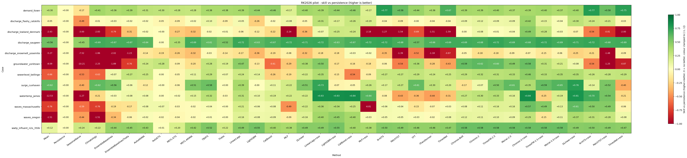

# Benchmark results

One consistent pass across **all 11 cases × 14 methods**, scored by **rolling-origin**
evaluation (12 refit origins per cell, errors pooled over origins × lead times, observed
points only). The headline cell is **skill vs persistence** = `1 − MSE(model)/MSE(persistence)`
at the primary horizon: positive means better than "tomorrow = today", `1.0` is perfect.

Regenerate with `uv run python scripts/run_pilot.py --with-fm`; per-case detail in
[`reports/`](reports/) via `scripts/case_report.py`. The two torch deep-learning methods
(N-HiTS / PatchTST) are reported separately below — they are slow on CPU, so this matrix is
the 14-method set (`--with-dl` adds them).

*Colour-coded cases × methods matrix (skill vs persistence; greener = better; colour clamped
to [−1, 1] so one catastrophic cell can't wash out the scale). Numbers + analysis below.*

## Skill vs persistence (rolling-origin, 12 origins)

| case | SeasonalNaive | AutoARIMA | DLinear | LightGBM | LightGBM+exo | Chronos-Bolt | best |
|---|---|---|---|---|---|---|---|
| discharge_lowland_denmark (slow hydrology) | −31.4 | +0.12 | +0.21 | −0.11 | +0.21 | −0.09 | **LinearLags+exo +0.30** |
| discharge_flashy_catskills (flashy) | −0.13 | +0.59 | +0.60 | −3.11 | +0.22 | **+0.80** | **Chronos +0.80** |
| discharge_snowmelt_yosemite | −34.3 | −0.05 | −0.28 | −0.08 | +0.47 | +0.03 | **LightGBM+exo +0.47** |
| groundwater_yorktown | −8.68 | +0.06 | +0.25 | **+0.65** | +0.65 | +0.30 | **LightGBM +0.65** |
| watertemp_james | −2.26 | +0.12 | +0.18 | +0.35 | **+0.84** | +0.21 | **LightGBM+exo +0.84** |
| sewerlevel_bellinge | −4.24 | +0.26 | −0.95 | **+0.31** | −0.45 | −0.57 | **LightGBM +0.31** |
| demand_ltown | +0.26 | +0.67 | +0.72 | **+0.74** | +0.74 | +0.70 | **LightGBM +0.74** |
| wwtp_influent_n2o_350k | −1.52 | +0.02 | +0.57 | **+0.69** | +0.69 | +0.63 | **LightGBM +0.69** |
| surge_cuxhaven | −1.15 | −0.03 | −0.02 | +0.00 | **+0.52** | −0.03 | **LightGBM+exo +0.52** |
| waves_oregon (swell) | −0.33 | +0.10 | +0.21 | +0.13 | **+0.48** | −0.18 | **LightGBM+exo +0.48** |
| waves_massachusetts (wind-sea) | −0.35 | +0.10 | +0.18 | +0.14 | **+0.51** | +0.11 | **LightGBM+exo +0.51** |

(`+exo` = the exogenous-aware Tier-2 variant; on `demand_ltown` / `wwtp_influent_n2o_350k`, which
declare no covariates, it equals the univariate column by construction.)

## What the matrix says

**1. Covariate-aware models win where covariates exist; plain boosting wins the regular,
self-driven series.** `LightGBM+exo` or `LinearLags+exo` is best on 8 of 11 cases; plain
`LightGBM` takes the three that are essentially self-driven (`demand_ltown` demand,
`wwtp_influent_n2o_350k` flow, `groundwater_yorktown`); `Chronos` zero-shot takes the flashy river. No
naive or classical method wins anywhere on these horizons.

**2. Domain covariates add large skill — exactly where the physics predicts.** The
exogenous-aware variants lift skill dramatically on the forced cases:

| case | driver | univariate → +exo (skill) |
|---|---|---|
| watertemp_james | air temperature | **+0.35 → +0.84** |
| surge_cuxhaven | ERA5 wind/pressure | **+0.00 → +0.52** |
| discharge_snowmelt_yosemite | temperature/precip | **−0.08 → +0.47** |
| waves_oregon / waves_massachusetts | wind | +0.13 → +0.48 / +0.14 → +0.51 |
| discharge_lowland_denmark | precipitation (via LinearLags) | +0.06 → +0.30 |
| groundwater_yorktown | (slow, integrative) | +0.65 → +0.65 — *no gain* |

Covariate value is real, case-specific, and tracks domain understanding. Groundwater is the
instructive null: the water table integrates weeks of recharge, which the target's own lags
already capture, so an instantaneous precip feature adds nothing.

**3. …but covariates are not free — they can hurt.** On `sewerlevel_bellinge`, adding the
oracle rain covariate *lowered* LightGBM from **+0.31 to −0.45**. At 15-min resolution the
rain→level response is sharp and variably-lagged; across rolling origins the model keys on
rain timing that doesn't generalise. An honest reminder that "physically relevant" ≠
"helps the forecast" — covariate engineering (lags, antecedent state) matters, and this case
is a candidate for the event-aware framing Rocco suggested.

**4. The usual winner is brittle on flashy daily flow.** Univariate `LightGBM` is the worst
method on `discharge_flashy_catskills` (**−3.11** — gradient boosting overfits the spiky daily
signal), while linear `DLinear` (+0.60), `AutoARIMA` (+0.59) and zero-shot `Chronos` (+0.80)
all do well; `+exo` rescues boosting to +0.22. So "boosting always wins" is false — on a
flashy regime the simpler and pretrained models are safer.

**5. MLP is the least robust method.** It collapses on the hard cases (`bellinge` −54,
`groundwater_yorktown` −1.8, `gesla` −1.3) where it extrapolates wildly. For a cross-case
benchmark, tree/linear models are the safe default.

**6. Seasonal-naive is a trap on trending series** — catastrophic on the slow hydrology /
groundwater cases (camels −31, snowmelt −34, groundwater −8.7) because the year-ago value is
meaningless there. The "obvious" seasonal baseline must be chosen per case.

## Foundation model (Chronos-Bolt, zero-shot)

The pretrained **Chronos-Bolt** forecasts each case **zero-shot — no case-specific
training**. The KER5 verdict is sharper than "FMs trail tuned models":

- **Where the signal is regular it is genuinely competitive** — it *wins the flashy
  discharge case outright* (**+0.80**, beating every fitted model) and is near-best on water
  demand (+0.70) and WWTP flow (+0.63), with no fitting at all. A pretrained model matching
  tuned ML on the well-behaved cases for free is the headline FM result.
- **Where the dynamics are noisy or covariate-driven it trails** — sewer (−0.57), waves
  (−0.18), surge (−0.03) — because it is univariate and cannot see the rainfall / wind that
  carries the skill.

So the FM is a **strong, free, but regime-dependent univariate prior**: adopt it where the
series is regular; it does not yet replace a covariate-aware model on the forced water cases.
Natural next steps: a **covariate-capable FM** (Chronos-2 / Moirai) and **fine-tuning** the
top zero-shot performer.

## Deep learning (N-HiTS / PatchTST)

Implemented directly on torch (`run_pilot --with-dl`) — the usual route (neuralforecast)
needs `ray`, which has no Python-3.13 wheels. A focused 4-case probe (rolling, 5 origins):

| case | N-HiTS | PatchTST | LightGBM (uni) | LightGBM+exo |
|---|---|---|---|---|
| surge_cuxhaven (1h) | +0.18 | +0.25 | +0.20 | +0.86 |
| waves_oregon (1h) | +0.11 | −0.33 | −0.03 | +0.40 |
| discharge_flashy_catskills (1d) | −0.05 | +0.05 | +0.24 | +0.90 |
| watertemp_james (1d) | −1.59 | −1.19 | −0.53 | +0.65 |

On the **hourly** cases (lookback 168 h covers the dynamics) N-HiTS/PatchTST beat persistence
and match univariate LightGBM (PatchTST best of the univariate methods on surge). On
**daily** cases the CPU-capped 64-day lookback can't see the annual cycle, and they are the
heaviest methods (PatchTST ~400 s/cell). Lookback + compute are the binding constraints a
**GPU (WSL)** would relax; full-coverage DL is deferred there. The neuralforecast zoo
(TFT/iTransformer/TimesNet, `--with-nf`) is wired and waiting for the WSL move.

## Caveats

- **One station/catchment per case.** Findings illustrate a regime, not a basin-wide
  generalisation study.
- **Covariates are a perfect-forecast proxy.** Future covariate values come from observed
  reanalysis (oracle), so the `+exo` numbers are an *upper bound* on operational covariate
  value; real skill depends on NWP forecast quality.
- **Rolling-origin cells are empirical estimates** that shift modestly with origin count;
  the qualitative ranking is stable. This whole matrix is one 12-origin pass.
- **CPU method set.** DLinear/N-HiTS/PatchTST run but with capped lookback/training budget;
  GPU (WSL) + the neuralforecast zoo + covariate-capable/fine-tuned FMs are next.
- **One primary horizon per case** here; the lead-time curves (`scripts/run_leadtime.py`,
  per-case reports) show how the ranking shifts as lead grows.
