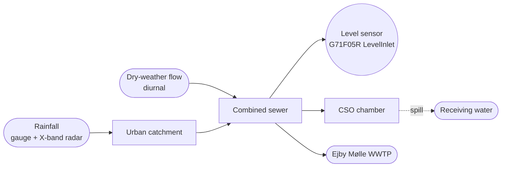
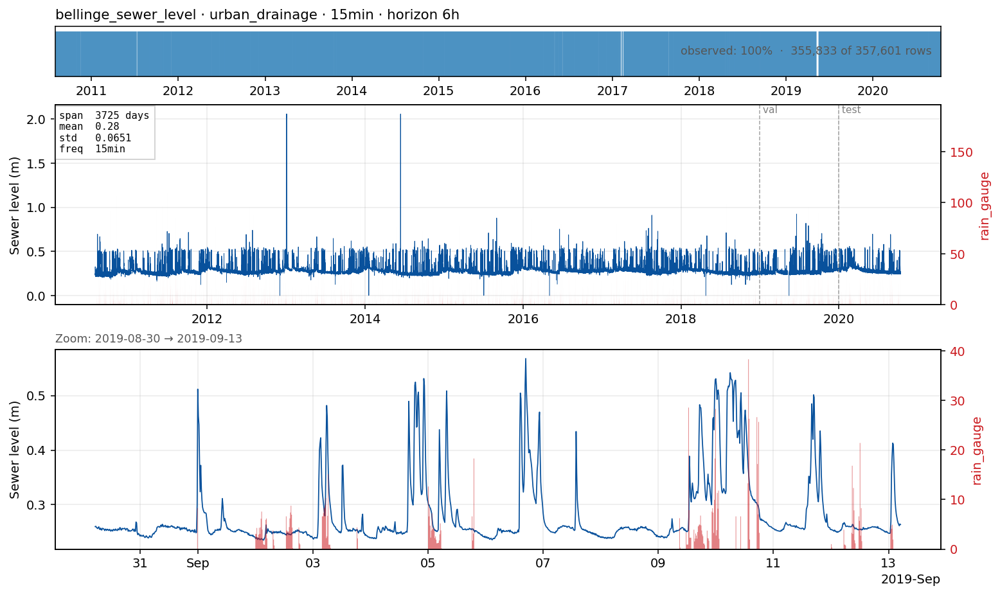

# `bellinge_sewer_level` — water level in a combined urban sewer

**Domain**: Urban drainage · **Target**: water level at a sewer-pipe sensor (m) · **Horizon**: 6 hours · **Data**: Bellinge (Odense, DK)

## What this is

A combined sewer carries both sanitary wastewater (a smooth diurnal pattern from human activity) *and* stormwater. Rain rapidly inflates the in-pipe water level; when the system fills, **combined sewer overflows (CSOs)** spill the excess to receiving waters. Real-time control and overflow warning depend on forecasting in-pipe levels a few hours ahead.

The Bellinge data set (Nedergaard Pedersen et al., 2021) is the canonical open urban-drainage research dataset: a real 1.7 km² combined sewer system in a suburb of Odense, with **10 years (2010–2020) of 1-minute observations** from 13 level meters plus rain gauges, X-band radar nowcasts, met-station data, the asset database, and full hydrodynamic models (MIKE Urban + EPA SWMM).
remove Level sensor F05R (unless it's shown to be at the inlet of the CSO chamber); connect CSO chamber to WWTP as most of the flow goes there (expect for the overflow).

Add caption, set y axis title to water level, use cleaned versioned of the data instead of raw (I assume from the visible spikes that you are using raw data); there doesn't seem to be a match between rainfall and water level: are you using the right rain gauge?

## The forecasting problem

Forecast **water level (m)** at sensor `G71F05R_LevelInlet_System2000p1`, resampled to **15 minutes**, **6 hours** ahead. Six hours is long enough to support operator decisions yet short enough that radar nowcasts carry skill. The sensor was selected by running `download --scan` over all 29 CSV members in the Bellinge `2_cleaned_data.zip`: of those that span the full 2010–2020 period, this one is 100% active (the paper-highlighted F04R Level1 instance is only 20% active over the same span under the System2000 SCADA system).
15 minutes might be too coarse, as you might miss or smoothen a spike?
2-6 hours is a good horizon, usually constrained by the validity of weather forecasts.
## Dynamics and drivers

Two regimes coexist: a clean diurnal dry-weather signal (where seasonal-naive "yesterday at this hour" is hard to beat), and rapid, rain-driven wet-weather peaks. The forecast challenge is **anticipating wet-weather peaks** — exactly where rainfall nowcasts and antecedent-moisture state turn into skill.

## Exogenous candidates
I believe the model was calibrated on rain gauges only. Not sure how helpful are the radar observations here.
- **Rain gauge** + **X-band local radar nowcast** (known-future) — the canonical operational drivers.
- **C-band DMI radar** — larger spatial coverage for incoming systems.
- **Antecedent dry-weather period** — key for CSO event onset.
- **Calendar features** — weekday vs weekend modulates the diurnal pattern.

## Operational relevance

Real-time control of weirs, gates, and pumps to use total system storage intelligently; CSO event prediction and EU/Danish spill reporting; WWTP coordination for influent surge management (bridges to `wwtp_influent`); asset management. Today the operational forecast is either a calibrated MIKE Urban / SWMM run forced by radar nowcast, or no quantitative forecast at all.

## References

- Nedergaard Pedersen et al. (2021). *The Bellinge data set.* ESSD 13, 4779. [doi:10.5194/essd-13-4779-2021](https://doi.org/10.5194/essd-13-4779-2021)
- Schütze et al. (2004). *Real-time control of urban wastewater systems — where do we stand today?* J. Hydrology 299, 335.
