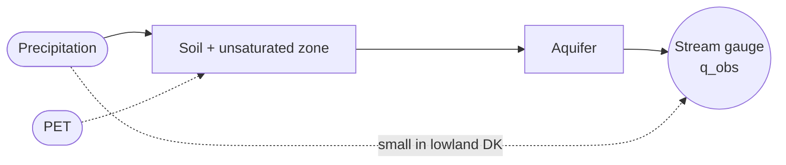
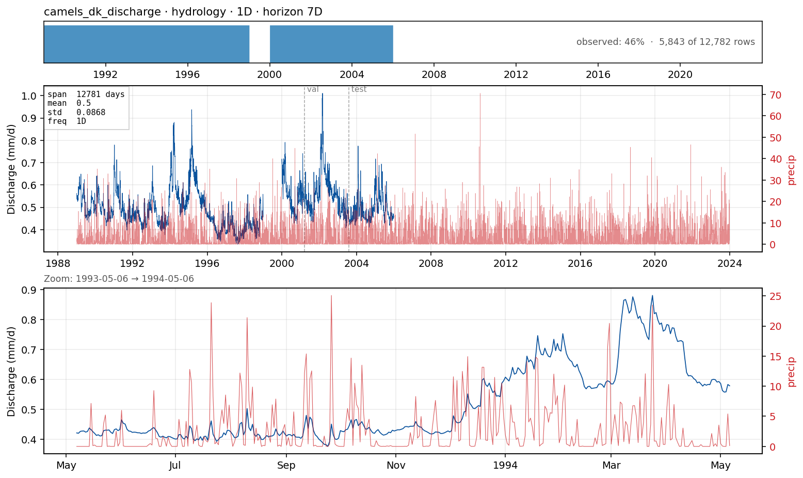

# `camels_dk_discharge` — daily river discharge in a Danish lowland catchment

**Domain**: Catchment hydrology · **Target**: daily streamflow at the outlet · **Horizon**: 7 days · **Data**: CAMELS-DK

## What this is

A *catchment* is the land area draining rainfall and snowmelt into one stream gauge. Danish catchments are overwhelmingly lowland and **groundwater-dominated**: water travels slowly through the aquifer before reaching the stream, so streamflow is unusually steady and the baseflow is the dominant signal.

CAMELS-DK (Koch et al., 2025) ships 1989–2019 daily hydrometeorological series for **3,330 Danish catchments**, of which **304 have observed streamflow**. Each catchment has forcings (precipitation, PET, temperature), groundwater states from the DK-model, attributes, and — for the gauged ones — `q_obs`.
this illustration is not very clear

the units on the axis seem off

## The forecasting problem
Agree on the forecast horizon
Forecast **`q_obs`** for the next **7 days** at one gauged catchment. The 7-day horizon is the operational window for reservoir release, environmental-flow compliance, and short-range flood warnings on slow-responding catchments.

We use catchment **`37470707`**, picked from `CAMELS_DK_signature_obs_based.csv` for **BFI 0.97** (very groundwater-dominated) and **slope 0.88** (lowland). That makes this catchment a regime where persistence is a hard baseline to beat — the deliberate worked example.

## Dynamics and drivers

The signal is dominated by slow baseflow recession from the aquifer, modulated by event precipitation and seasonal PET. Antecedent soil moisture amplifies the response to rainfall. Short-horizon (1–3 d) is nearly persistence; medium-horizon (4–7 d) starts to depend on the precipitation forecast.

## Exogenous candidates

- **Precipitation**, **PET**, **temperature** — already in the case Parquet.
- **Antecedent moisture** and **DK-model state variables** (groundwater head, saturated zone storage) — ship with CAMELS-DK.
- **DK-model simulated discharge `q_sim`** — the obvious *process-model reference column* and residual-correction baseline. Most realistic "what a client receives today".

## Operational relevance

Water-resource planning (utilities, reservoir scheduling), regulatory minimum-flow compliance (EU WFD), short-range flood warnings for slow-responding catchments, and short-range bias correction of the operational DK-model. The realistic operational pipeline is **NWP precipitation → DK-model → ML post-processing against recent obs** (not sure about the post-processing works here); the benchmark question is whether pure ML beats that, or whether the hybrid is the right answer.

## References

- Koch et al. (2025). *CAMELS-DK.* ESSD 17, 1551. [doi:10.5194/essd-17-1551-2025](https://doi.org/10.5194/essd-17-1551-2025)
- Kratzert et al. (2019). *LSTM hydrological forecasting on large-sample datasets.* HESS 23, 5089.
