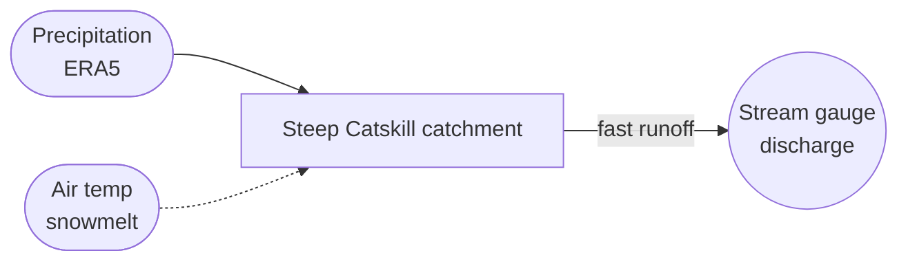
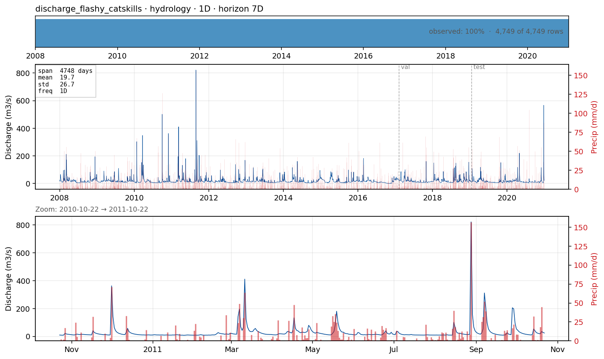

# `discharge_flashy_catskills` — daily streamflow in a flashy rainfall-driven catchment

**Domain**: Catchment hydrology · **Target**: daily discharge (m³/s) · **Horizon**: 7 days · **Data**: USGS NWIS 01362500

## What this is

The deliberate **flashy counterpart** to [`discharge_lowland_denmark`](discharge_lowland_denmark.md). Where the Danish lowland catchment is groundwater-dominated and slow (persistence is hard to beat), Esopus Creek at Coldbrook, NY drains the **Catskill Mountains** — steep, thin-soiled, rainfall- and snowmelt-driven. Storms produce sharp flood peaks within a day; the recession is fast. Running the *same* target and 7-day horizon across the two regimes is the cross-case question from the plan: does a method's ranking hold when the hydrology flips from slow to fast?

Data is daily discharge from the USGS National Water Information System (public domain), converted cfs → m³/s, paired with ERA5 precipitation + air temperature at the gauge (fetched credential-free via Open-Meteo).

## The forecasting problem

Forecast **discharge** at the gauge, **daily**, **7 days** ahead. Days 1–2 are near-persistence (the current flood wave is in the channel); days 3–7 depend on the **precipitation forecast** — exactly where the rainfall covariate turns into skill. Richards–Baker flashiness ≈ 0.3 (vs the near-flat DK catchment), so the wet-weather peaks dominate the error.

## Dynamics and drivers

A modest baseflow recession plus large, short rainfall-driven peaks. Antecedent soil moisture modulates the response; cool-season events are amplified by snowmelt (hence air temperature as a driver). Strongly right-skewed — a handful of flood days carry most of the RMSE.

## Exogenous candidates

- **ERA5 precipitation** (the dominant driver) and **air temperature** (snowmelt timing) at the gauge point — implemented as a perfect-forecast proxy (observed reanalysis standing in for an NWP precipitation forecast).
- Antecedent-precipitation accumulations and a snow-water-equivalent proxy are natural Tier-2 additions.

## Operational relevance

Short-range flood warning, reservoir inflow forecasting, environmental-flow compliance. Flashy mountain catchments are where data-driven nowcasting competes hardest with rainfall-runoff models, so this is a commercially representative contrast to the slow DK case.

## References

- U.S. Geological Survey, National Water Information System — site [01362500](https://waterdata.usgs.gov/monitoring-location/01362500/) (Esopus Creek at Coldbrook, NY).
- Baker et al. (2004). *A new flashiness index.* J. American Water Resources Assoc. 40, 503.
