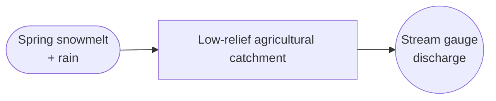
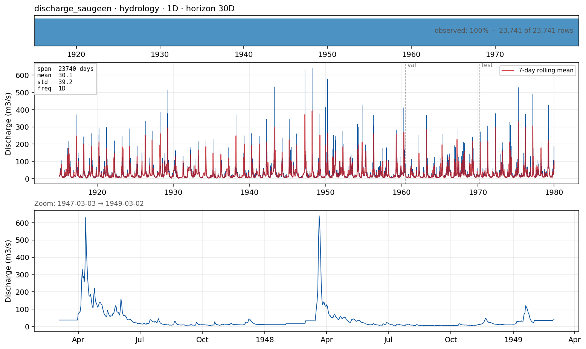

# `discharge_saugeen` — daily river discharge, canonical univariate benchmark

**Domain**: Catchment hydrology · **Target**: daily discharge (m³/s) · **Horizon**: 30 days · **Data**: Monash Time Series Forecasting Archive (WSC 02FC002)

## What this is

A **pure univariate** counterpart to the exogenous-driven discharge cases. The Saugeen River near Walkerton, Ontario drains a low-relief agricultural plain on the Bruce Peninsula; the record — 1915–1979, 65 years, no gaps — is one of the canonical long daily hydrology series in the Monash Time Series Forecasting Archive (Godahewa et al., 2021) and is widely used as an M4/M3-style univariate benchmark in the forecasting literature. No forcing covariates ship with it: the question this case poses is how far autoregressive structure and seasonality alone (no rainfall, no temperature) carry a 30-day-ahead forecast.

## The forecasting problem

Forecast **discharge** at the gauge, **daily**, primary horizon **30 days** (also evaluated at 7 and 14 days), from a 60-day input window. With no exogenous inputs (`case_exo_tier = "none"`), every model in the benchmark sees the same information here — this case isolates pure time-series skill (autoregression, seasonality, trend) from the exogenous-forecast skill that the other hydrology cases add on top.

## Dynamics and drivers

A snowmelt-dominated regime: a sharp spring freshet (April–May) as accumulated snowpack melts, receding through summer to low baseflow, with smaller rain-driven pulses in late autumn. Because there is no covariate to anchor the 30-day horizon, skill at long lead times depends on how well a model captures the recurring seasonal shape (climatology / seasonal-naive is a strong baseline) versus how much extra it can extract from the last 60 days of antecedent state.

## Exogenous candidates

None — this is a deliberately univariate case. Precipitation, temperature, and snow-water-equivalent at the basin are the obvious candidates if the case were ever extended, but the point of `discharge_saugeen` in the suite is to hold those out and let it be the "no covariates" control case, paired against [`discharge_lowland_denmark`](discharge_lowland_denmark.md) and [`discharge_flashy_catskills`](discharge_flashy_catskills.md), which forecast the same kind of target but with exogenous forcing available.

## Operational relevance

Long-lead (multi-week) streamflow outlooks for reservoir operation and agricultural water allocation in data-sparse settings where forcing covariates (NWP precipitation, snow surveys) aren't reliably available — the realistic case for many smaller or historically-instrumented basins. Also a standard reference series for benchmarking univariate forecasting methods in the wider literature, which makes it a useful cross-check that this benchmark's baselines reproduce known-good behaviour before trusting its exogenous-case results.

## References

- Godahewa, R., Bergmeir, C., Webb, G. I., Hyndman, R. J., & Montero-Manso, P. (2021). *Monash Time Series Forecasting Archive.* NeurIPS Datasets and Benchmarks. [doi:10.5281/zenodo.4656058](https://doi.org/10.5281/zenodo.4656058)
- Water Survey of Canada — station 02FC002 (Saugeen River near Walkerton, ON).
