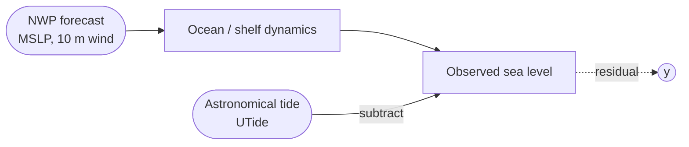
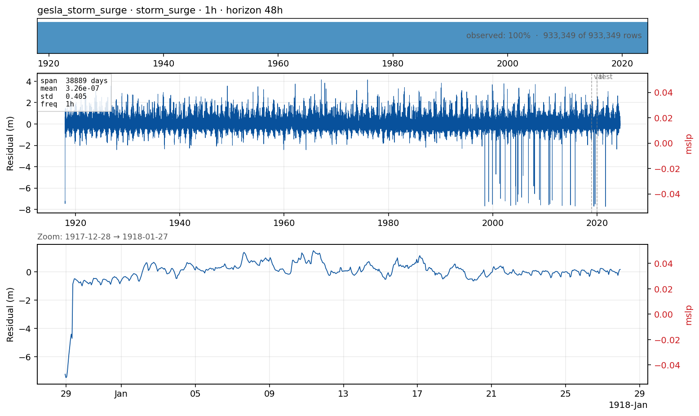

# `gesla_storm_surge` — non-tidal sea-level residual at a coastal tide gauge

**Domain**: Storm surge · **Target**: non-tidal residual (m) · **Horizon**: 48 hours · **Data**: GESLA-3

## What this is

Coastal sea level = astronomical tide (predictable to centimetres years ahead) + mean sea-level trend + **non-tidal residual**. The residual is dominated by meteorological forcing: low pressure lifts the surface (~1 cm per 1 hPa, the inverse barometer effect) and onshore winds pile water against the coast (wind setup). When a storm coincides with high tide, this is the **storm-surge** flood-risk problem.

We forecast the *residual*, not the raw level: the tide is removed via UTide harmonic analysis before the canonical Parquet is written, so this case is exclusively about the meteorologically driven part. GESLA-3 (Haigh et al., 2023) provides **5,119 stations globally**, sub-hourly resolution, unified to UTC with QC flags.

## The forecasting problem

Forecast the **non-tidal residual** at one tide gauge, **hourly**, **48 hours** ahead. The horizon matches operational coastal-flood-warning lead times (DMI, Met Office, NOAA).

Station pinned to **Cuxhaven_Steubenhoft (`Cux`)** by `--scan` over the UK + Atlantic NW Europe bounding box: shallow German Bight shelf, surge-rich climate (the 1962 Hamburg flood site), operational benchmark for the Elbe estuary and Hamburg port. The gauge record runs 1917–2024; the canonical Parquet is **trimmed to 2000–2024** so the ERA5 forcing covers the whole series (the splits only use 2017–2020, with ample training history before).

## Dynamics and drivers

Inverse barometer + wind setup, both highly nonlinear in shallow shelves like the North Sea. Tide-surge interaction modulates the signal nonlinearly with the tide. Far-field forcing (a storm in the Norwegian Sea drives a Kelvin wave to the German Bight days later) adds a long-memory component. Persistence works for a few hours; beyond ~6–12 h, **skill comes almost entirely from the meteorological forecast** driving the surge — this is the canonical case for *known-future* exogenous dominance.

## Exogenous candidates

- **ERA5 MSLP + 10 m wind** (`mslp`, `u10`, `v10`) at the station point — **implemented**,
  fetched credential-free via Open-Meteo's ERA5 archive. These are the physical surge
  drivers; on the data, `u10` correlates with the residual at Spearman ≈ 0.73.
- **Known-future semantics**: in the benchmark these fields are listed as known-future and
  fed to the exogenous-aware methods as a **perfect-forecast (oracle) proxy** — observed
  reanalysis standing in for the NWP (IFS/GFS) wind/pressure *forecast* an operational
  system would actually use. The numbers are therefore an upper bound on covariate value;
  real skill depends on the forecast forcing quality.
- **Process-model reference column** (Copernicus Marine surge; hybrid ML residual
  correction): not implemented — its scope is an open decision (see
  [`review_responses_pr2.md`](../review_responses_pr2.md) E4).

The exogenous uplift is large and grows with lead: covariate-aware LightGBM lifts
skill-vs-persistence from ≈0.30 (univariate) to ≈0.64, and at 36 h lead cuts rolling-origin
RMSE ~35% below persistence — the canonical "skill comes from the meteorology" result.

## Operational relevance

Coastal flood warnings (DMI, EFAS), port closures and mooring decisions, sluice/gate operation (Maeslantkering, Thames Barrier), dyke-height design via extreme-value analysis. For DHI specifically this case bridges the benchmark to **MIKE 21** hydrodynamic forecasts — any external publication should be honest that MIKE-21 + bias correction is the realistic operational competition.

## References

- Haigh et al. (2023). *GESLA Version 3.* Geoscience Data Journal 10, 293. [doi:10.1002/gdj3.174](https://doi.org/10.1002/gdj3.174)
- Codiga (2011). *UTide.* Tide harmonic analysis (Python port `utide`).
- Copernicus Marine global surge: [data.marine.copernicus.eu](https://data.marine.copernicus.eu/)
