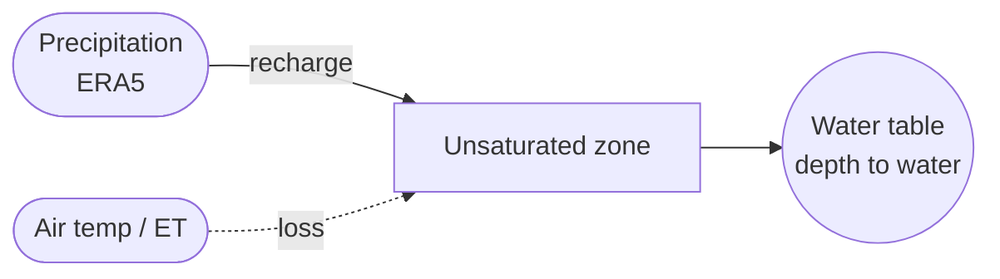
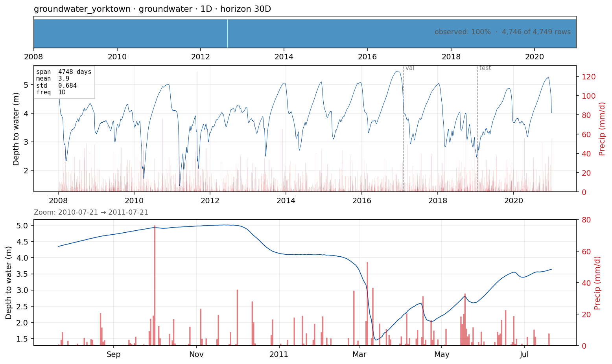

# `groundwater_yorktown` — daily water-table depth in a shallow aquifer

**Domain**: Groundwater / water resources · **Target**: depth to water (m below surface) · **Horizon**: 30 days · **Data**: USGS NWIS We-5020

## What this is

Groundwater is the slow end of the water cycle: the water table integrates weeks-to-months of recharge, so the signal is smooth and strongly autocorrelated. This case forecasts **depth to water** at USGS observation well **We-5020** (Yorktown Heights, NY), a shallow water-table aquifer with a continuous daily record and a ~13 m seasonal range. It covers the water-resources domain the plan earmarked for GEMS-GER, using a credential-free USGS well instead.

Larger depth-to-water = lower water table. Recharge (rain reaching the aquifer) raises the table (depth decreases); drainage and evapotranspiration lower it. Exogenous forcing is ERA5 precipitation + air temperature at the well (Open-Meteo).

*EDA panel: daily depth to water (m below surface) at well We-5020, with ERA5
precipitation overlaid. Note the y-axis is depth, so a *rising* water table shows as a
*falling* line.*

## The forecasting problem

Forecast **depth to water**, **daily**, **30 days** ahead — a longer horizon than the surface-water cases because the system is slow and a month-ahead water-table outlook is the operationally useful product (irrigation, well-field management, low-flow forecasting). Persistence is a very strong baseline; the open question is whether antecedent precipitation buys skill at 2–4 weeks.

## Dynamics and drivers

Slow recharge–discharge balance: a near-linear decline between events, punctuated by recharge rises after wet spells (lagged days–weeks behind rainfall). Warm-season evapotranspiration deepens the table. The single-lag correlation with rainfall is therefore weak — the real driver is **accumulated** antecedent precipitation, which the windowed-ML lags partly capture.

## Exogenous candidates

- **ERA5 precipitation** (recharge) and **air temperature** (ET) at the well, as a perfect-forecast proxy.
- Antecedent-precipitation accumulations (30/90-day) are the highest-leverage Tier-2 feature for this slow system.

## Operational relevance

Well-field and irrigation management, baseflow and low-flow forecasting, drought early warning, and saltwater-intrusion risk in coastal aquifers. A month-ahead water-table forecast directly supports abstraction planning.

## References

- U.S. Geological Survey, National Water Information System — well [411421073481202](https://waterdata.usgs.gov/monitoring-location/411421073481202/) (We-5020, Yorktown Heights, NY).
