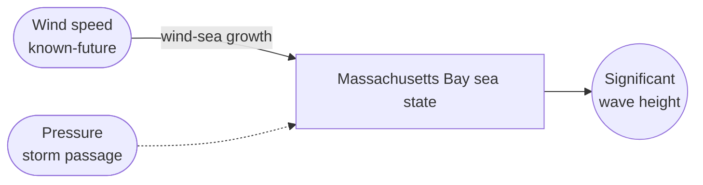
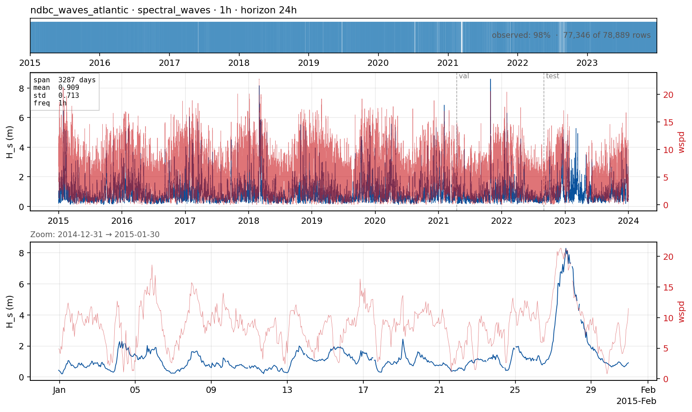

# `ndbc_waves_atlantic` — significant wave height in a wind-sea Atlantic regime

**Domain**: Spectral waves · **Target**: significant wave height H_s (m) · **Horizon**: 24 hours · **Data**: NDBC buoy 44013

## What this is

The **regime contrast** to [`ndbc_waves`](ndbc_waves.md). Buoy 46050 (Oregon) sits in the open Pacific and is **swell-dominated** — long-period energy arriving from distant storms, so the sea state has long memory and persistence is strong. Buoy **44013** (Boston, Massachusetts Bay) is **fetch-limited wind-sea**: H_s responds quickly to local wind and nor'easters, with shorter memory. Forecasting the same target and horizon at both buoys tests whether method ranking is robust across wave climates — a wind-driven sea should reward the wind covariate far more than a swell-dominated one.

Data is hourly NDBC standard-meteorological records (public domain); exogenous come from the same buoy's wind, pressure and temperatures.

## The forecasting problem

Forecast **H_s**, **hourly**, **24 hours** ahead. Wind speed is listed as **known-future**: an operational wave forecast is driven by an NWP wind *forecast*, which we proxy here with the observed wind (a perfect-forecast upper bound). In the wind-sea regime the wind covariate should lift skill well beyond persistence as lead grows — the opposite balance to the swell-dominated Pacific case.

## Dynamics and drivers

Wind-sea growth and decay on hours-timescales, modulated by fetch and storm passage (pressure). Shorter memory than open-ocean swell, so persistence decays faster with lead time and the wind forecast matters earlier. Buoy outages produce gaps (handled by fraction splits + NaN-masked scoring).

## Exogenous candidates

- **Wind speed** (dominant, known-future) and **pressure** (storm passage, known-future).
- **Air / water temperature** (stability, historical) as secondary covariates.
- ERA5/GFS wind *forecasts* would replace the perfect-forecast proxy in an operational setting.

## Operational relevance

Coastal and harbour operations, small-craft advisories, offshore wind O&M weather windows, and surf/ship-routing — all in a fetch-limited shelf sea where local wind, not distant swell, sets the hazard.

## References

- NOAA National Data Buoy Center — station [44013](https://www.ndbc.noaa.gov/station_page.php?station=44013) (Boston, MA), standard meteorological data.
