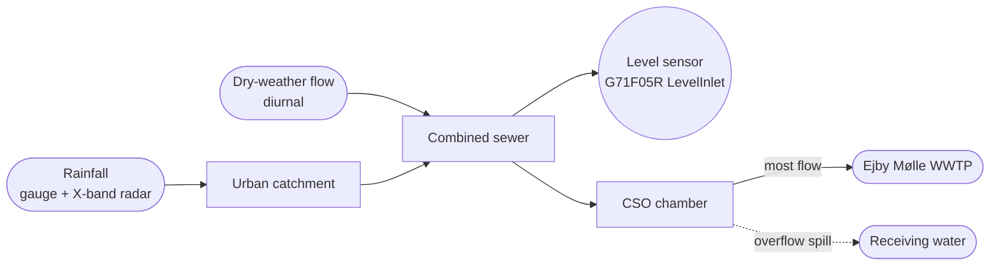
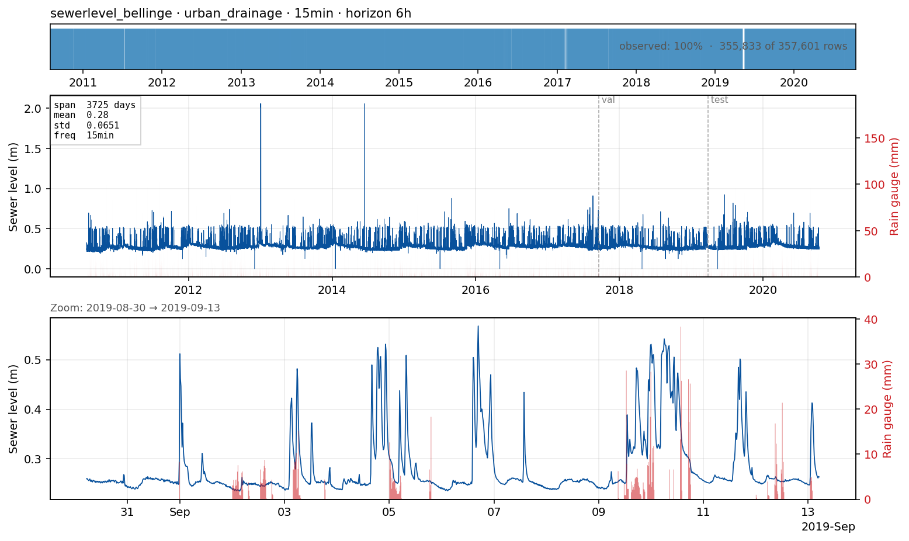

# `sewerlevel_bellinge` — water level in a combined urban sewer

**Domain**: Urban drainage · **Target**: water level at a sewer-pipe sensor (m) · **Horizon**: 6 hours · **Data**: Bellinge (Odense, DK)

## What this is

A combined sewer carries both sanitary wastewater (a smooth diurnal pattern from human activity) *and* stormwater. Rain rapidly inflates the in-pipe water level; when the system fills, **combined sewer overflows (CSOs)** spill the excess to receiving waters. Real-time control and overflow warning depend on forecasting in-pipe levels a few hours ahead.

The Bellinge data set (Nedergaard Pedersen et al., 2021) is the canonical open urban-drainage research dataset: a real 1.7 km² combined sewer system in a suburb of Odense, with **10 years (2010–2020) of 1-minute observations** from 13 level meters plus rain gauges, X-band radar nowcasts, met-station data, the asset database, and full hydrodynamic models (MIKE Urban + EPA SWMM).

> **Note (Rocco, PR #2).** The bulk of the flow through the CSO chamber continues to the
> WWTP; only the overflow spills to receiving water — the diagram now reflects this. The
> target sensor `G71F05R_LevelInlet` should be confirmed against the Bellinge asset
> database: if it sits at the inlet of the CSO chamber, an event-aware CSO framing becomes
> the more compelling case (see "The forecasting problem").

*EDA panel: water level (m) at `G71F05R_LevelInlet`, 15-min resample, with rainfall (SVK
gauge 5425) overlaid. The rain↔level misalignment Rocco flagged in PR #2 was a
wrong-rain-gauge bug, fixed by switching to SVK 5425 (commit `b05481f`). **Known issue,
not yet fixed:** the two isolated ~2 m plateaus visible around 2013 and mid-2014 are a
stuck-sensor/logger fault (the same value holds for ~67 hours, recurring across
unrelated dates) — not real dynamics, and not removed by the current gap-fill/curation
pipeline. Despiking this is logged as follow-up work.*

## The forecasting problem

Forecast **water level (m)** at sensor `G71F05R_LevelInlet_System2000p1`, resampled to **15 minutes**, **6 hours** ahead. Six hours is long enough to support operator decisions yet short enough that rainfall nowcasts carry skill; in practice the useful horizon is bounded by the validity of the rainfall forecast (2–6 h). The sensor was selected by running `download --scan` over all 29 CSV members in the Bellinge `2_cleaned_data.zip`: of those that span the full 2010–2020 period, this one is 100% active (the paper-highlighted F04R Level1 instance is only 20% active over the same span under the System2000 SCADA system).

> **Open points (Rocco, PR #2).**
> - **Resampling resolution.** 15 min may be too coarse — it can smooth out or miss short
>   wet-weather peaks. For the event-aware framing, prefer a peak-preserving aggregation
>   (max-in-bin) over a plain mean, or a finer step.
> - **Sensor framing.** A CSO-chamber level (with event hit-rate / peak-level-bias metrics)
>   may be more operationally compelling than a continuous in-pipe level — confirm what
>   `G71F05R_LevelInlet` measures first.

## Dynamics and drivers

Two regimes coexist: a clean diurnal dry-weather signal (where seasonal-naive "yesterday at this hour" is hard to beat), and rapid, rain-driven wet-weather peaks. The forecast challenge is **anticipating wet-weather peaks** — exactly where rainfall nowcasts and antecedent-moisture state turn into skill.

This is a case where **univariate forecasting is only a floor** — the wet-weather peaks
*are* the rainfall response, so rainfall is essential, not optional.

> **Caveat on rainfall as a "forecast".** In this benchmark we feed *observed* rainfall as
> a known-future input. That is a **perfect-forecast (oracle) proxy**, not an operational
> rainfall forecast — real skill at 6 h depends on the quality of an actual rainfall
> nowcast/forecast. We state this explicitly so the numbers aren't over-read.

- **Rain gauge** (primary) — the Bellinge hydrodynamic models were calibrated on rain
  gauges, so this is the canonical, sufficient driver. *(Per Rocco, PR #2.)*
- **X-band local radar nowcast** (known-future) — included for completeness, but its
  *added value over the rain gauge here is uncertain* and worth testing rather than assuming.
- **C-band DMI radar** — larger spatial coverage for incoming systems.
- **Antecedent dry-weather period** — key for CSO event onset.
- **Calendar features** — weekday vs weekend modulates the diurnal pattern.

## Operational relevance

Real-time control of weirs, gates, and pumps to use total system storage intelligently; CSO event prediction and EU/Danish spill reporting; WWTP coordination for influent surge management (bridges to `wwtp_influent_n2o_350k`); asset management. Today the operational forecast is either a calibrated MIKE Urban / SWMM run forced by radar nowcast, or no quantitative forecast at all.

## References

- Nedergaard Pedersen et al. (2021). *The Bellinge data set.* ESSD 13, 4779. [doi:10.5194/essd-13-4779-2021](https://doi.org/10.5194/essd-13-4779-2021)
- Schütze et al. (2004). *Real-time control of urban wastewater systems — where do we stand today?* J. Hydrology 299, 335.
