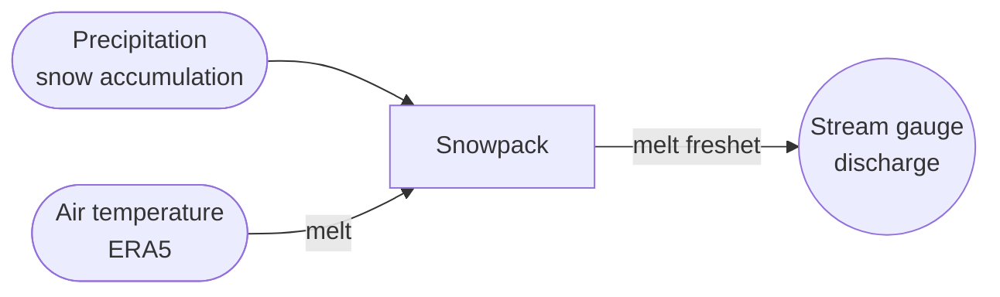
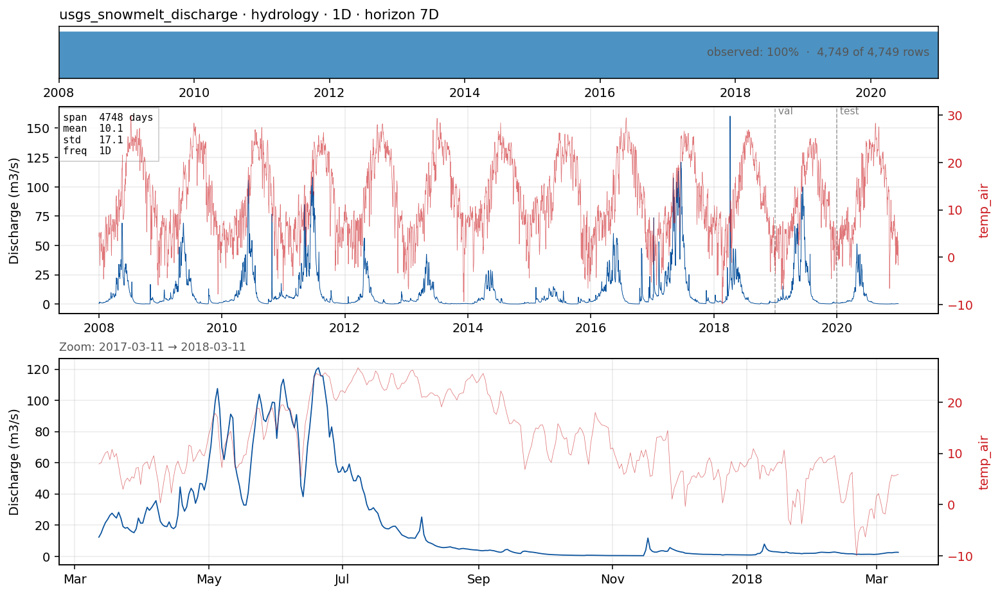

# `usgs_snowmelt_discharge` — daily streamflow in a snowmelt-dominated mountain river

**Domain**: Catchment hydrology · **Target**: daily discharge (m³/s) · **Horizon**: 7 days · **Data**: USGS NWIS 11264500

## What this is

The **third hydrology regime** in the benchmark, completing a deliberate contrast set:

- `camels_dk_discharge` — **slow**, groundwater-dominated lowland (persistence is hard to beat);
- `usgs_river_discharge` — **flashy**, rainfall-driven Catskill river (sharp storm peaks);
- `usgs_snowmelt_discharge` — **snowmelt**, the Merced River at Happy Isles in Yosemite.

The Merced hydrograph is smooth and strongly seasonal: a snowpack builds through winter and
releases as a broad spring/summer melt freshet whose timing is set by **air temperature**,
not by individual rain events. Running the same target and 7-day horizon across all three
asks the cross-case question directly — does a method's ranking survive when the dominant
driver switches from groundwater storage to rainfall to temperature-driven melt?

Discharge is daily USGS data (cfs → m³/s); forcing is ERA5 air temperature (primary) and
precipitation at the gauge (Open-Meteo, credential-free).

## The forecasting problem

Forecast **discharge**, **daily**, **7 days** ahead. The smooth melt hydrograph makes
persistence very strong day-to-day; skill at multi-day lead comes from the **temperature
forecast** that governs melt rate. Unlike the flashy case, the challenge is not sharp peaks
but getting the rising/falling limb of the seasonal freshet right.

## Dynamics and drivers

A snow-accumulation/melt balance: precipitation below freezing builds the pack; warm days
release it with a routing lag. Discharge therefore lags temperature by days and peaks in
late spring. Inter-annual variability is driven by snowpack size, so antecedent
cool-season precipitation matters as much as current temperature.

## Exogenous candidates

- **ERA5 air temperature** (dominant — melt energy) and **precipitation** (snowpack
  recharge), as a perfect-forecast proxy.
- Snow-water-equivalent (SNOTEL) and accumulated degree-days are the natural Tier-2
  additions for a melt model.

## Operational relevance

Reservoir inflow and water-supply forecasting (the Sierra snowpack supplies California),
spring flood-risk timing, and hydropower scheduling — all dominated by *when* the snow
melts, which is exactly the temperature-driven signal this case exposes.

## References

- U.S. Geological Survey, National Water Information System — site [11264500](https://waterdata.usgs.gov/monitoring-location/11264500/) (Merced River at Happy Isles Bridge, Yosemite, CA).
