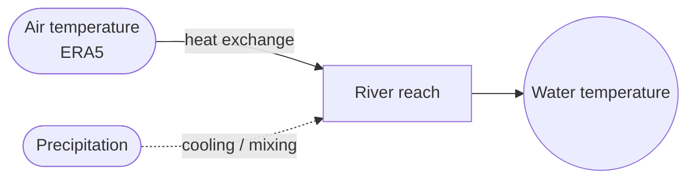
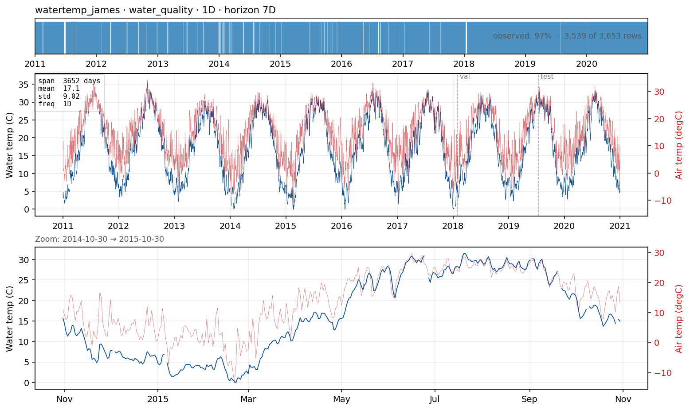

# `watertemp_james` — daily river water temperature

**Domain**: Water quality / ecology · **Target**: water temperature (°C) · **Horizon**: 7 days · **Data**: USGS NWIS 02035000

## What this is

River water temperature governs dissolved-oxygen, fish habitat, and thermal-discharge compliance. It is the **exogenous-dominated** counterpart to the flow cases: water temperature tracks **air temperature** closely (lagged and damped by the river's thermal inertia), so a univariate model is a weak floor and the covariate carries most of the skill. The target is daily water temperature at the **James River at Cartersville, VA** (USGS 02035000); forcing is ERA5 air temperature + precipitation at the gauge (Open-Meteo).

## The forecasting problem

Forecast **water temperature**, **daily**, **7 days** ahead. The diurnal-to-seasonal cycle is set by air temperature; skill at multi-day lead comes almost entirely from the **air-temperature forecast** (here a perfect-forecast proxy). On the data, water temperature correlates with air temperature at Spearman ≈ 0.96 and adding the covariate cuts one-step error ~30%.

## Dynamics and drivers

First-order thermal response: water temperature relaxes toward an equilibrium set by air temperature and solar forcing, with a few days of memory. Storms briefly cool and mix the reach. The signal is bounded below by 0 °C and has a strong, very predictable seasonal cycle — making this a case where **climatology and seasonal-naive are strong**, and the question is how much the air-temperature covariate adds on top.

## Exogenous candidates

- **ERA5 air temperature** (dominant) and **precipitation** (secondary, storm cooling), as a perfect-forecast proxy.
- Solar radiation and discharge (dilution/mixing) are natural Tier-2 additions.

## Operational relevance

Thermal-compliance monitoring for power-plant and industrial discharges, aquatic-habitat and fish-kill risk, dissolved-oxygen forecasting, and reservoir release scheduling for downstream temperature targets.

## References

- U.S. Geological Survey, National Water Information System — site [02035000](https://waterdata.usgs.gov/monitoring-location/02035000/) (James River at Cartersville, VA).
