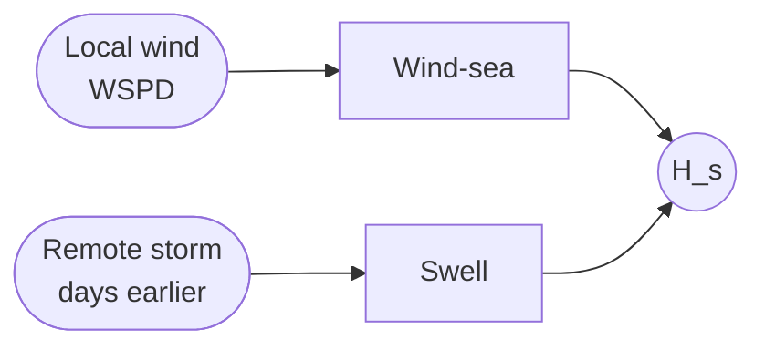
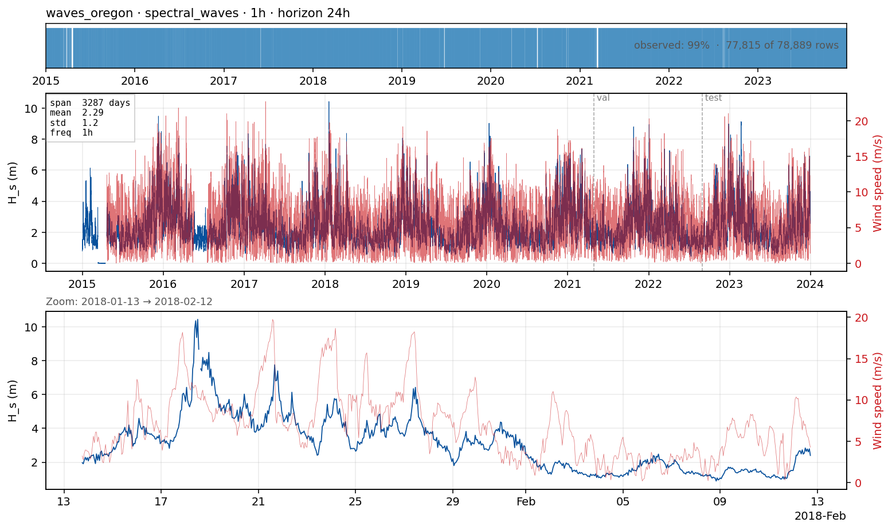

# `waves_oregon` — significant wave height at a coastal/offshore buoy

**Domain**: Spectral waves · **Target**: significant wave height H_s (m) · **Horizon**: 24 hours · **Data**: NOAA NDBC station 46050

## What this is

H_s is the operational currency of ocean engineering: the standard deviation × 4 of surface elevation, equivalent to the average height of the largest one-third of waves. Waves at any location are a superposition of **wind-sea** (locally generated by the wind, fast-responding) and **swell** (propagated from distant storms, hours-to-days lag, decoupled from local wind).

NDBC standard-meteorological files (NOAA) are the global standard for buoy observations: hourly wind, gust, wave parameters (H_s, dominant + average period, mean direction), pressure, air/water temperature, delivered as yearly text files at stable URLs. **Station 46050 (Stonewall Bank, Oregon)** is an open-ocean Pacific buoy with a long, energetic, swell-rich record — we use 2015–2023.

*EDA panel: hourly significant wave height H_s (m) at buoy 46050, with the buoy's own
wind speed overlaid. The zoom window is centred on the month with the largest swell
event.*

## The forecasting problem

Forecast **`wvht` (H_s, metres)**, **hourly**, **24 hours** ahead. The 24 h horizon supports marine operations, surf and recreation, offshore vessel-to-platform transfers. Longer horizons (48–72 h) are secondary metrics relevant to commercial shipping.

## Dynamics and drivers

Sea-state autocorrelation is high at short lead — persistence is a strong baseline for 1–6 h. From ~6 h, the value of **forecast wind** dominates wind-sea growth. From ~24 h, swell propagation from distant storms is required, which is what spectral wave models (WaveWatch III, SWAN) do operationally. This case is the showcase where the univariate-vs-exogenous gap should be most visible.

## Exogenous candidates

- **Local wind speed, gust, MSLP** at the buoy (already in the Parquet) — past values for state, forecast values for the actual skill source.
- **NWP wind forecast** (ERA5 / IFS / GFS at the buoy point) — the canonical known-future exogenous.
- **Upstream / regional wave hindcast** (Copernicus wave reanalysis, neighbour buoys) — encodes incoming swell.
- **Peak period T_p** is a natural secondary target on the same dataset; carries sea-state-regime information (choppy vs long swell), critical for engineering.

## Operational relevance

Vessel routing (heavy seas avoidance vs fuel/time trade-offs), offshore-infrastructure installation and maintenance windows, surf and recreational forecasting, wave-energy converter operations. The operational landscape is dominated by global spectral wave models (WaveWatch III, SWAN) forced by NWP wind, plus regional Copernicus distributions. The benchmark question: can lightweight ML with the right features match a global wave model at a single point? — usually yes for local wind-sea, less so for distant swell.

A Danish North Sea counterpart (DMI buoy or Copernicus NW Shelf hindcast point) is a natural local case; case ID `waves_oregon` is generic enough to swap.

## References

- NOAA NDBC. *Standard Meteorological Data.* [ndbc.noaa.gov](https://www.ndbc.noaa.gov/)
- Tolman et al. (2019). *WAVEWATCH III User Manual.*
- Copernicus Marine wave hindcast: [data.marine.copernicus.eu](https://data.marine.copernicus.eu/)
