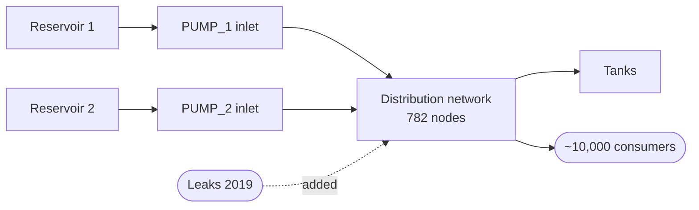

# `wd_battledim` — inlet flow into a water distribution network

**Domain**: Water distribution · **Target**: inlet pump flow (L/s) · **Horizon**: 24 hours · **Data**: BattLeDIM L-Town (Cyprus)

## What this is

A water distribution network delivers treated drinking water from sources through a pressurised pipe system to consumers. There's almost no storage *inside* the network, so total inlet flow equals total consumer **demand** in near-real-time. Forecasting demand 24 hours ahead drives pump scheduling, energy contracts, and is the baseline against which leaks are detected.

**BattLeDIM 2020** (Vrachimis et al., 2020) models **L-Town**, a real Cyprus network with 2 reservoirs, 782 nodes, 905 pipes, ~10,000 consumers. The data is **EPANET-simulated SCADA at 5-min**, covering 2018 (training) and 2019 (evaluation with introduced leak events).

## The forecasting problem

Forecast **total inlet flow** (sum of all PUMP_* columns) at **hourly** resolution, **24 hours** ahead. The hourly cadence matches operational pump scheduling; 24 h spans a full diurnal cycle. We deliberately sum across pumps because **the individual pumps alternate** (operational scheduling): forecasting one pump alone is forecasting a pump-on/off switch rather than network demand.

The data being simulated is a feature: ground truth is exact, no sensor noise, demand drivers are clean. The case is also the standard reference for leak-detection research, so methods have an obvious downstream application.

## Dynamics and drivers

Three highly predictable components dominate: a strong diurnal pattern (morning + evening peaks, deep overnight minimum), a weekly modulation (weekday ~5–10% higher than weekend), and a summer seasonal lift (irrigation, especially in Cyprus). On top of that: small noise, occasional industrial spikes, and (in 2019) leak-induced anomalies. **A small calendar + temperature feature set already explains most of the variance** — seasonal-naive and gradient-boosting baselines are strong here.

## Exogenous candidates

- **Calendar features**: hour, day-of-week, month, holidays (almost all the signal).
- **Temperature** — drives outdoor / summer demand. ERA5 reanalysis at the L-Town location is the natural source.
- **Other district inlet flows / tank levels** — mass-balance constraints if multiple zones forecast jointly.
- **Leak ground truth (2019)** — counterfactual exogenous for anomaly-baseline studies.

## Operational relevance

Pump scheduling and energy optimisation (pumps are the bulk of a utility's electricity bill; off-peak shifting and tank storage exploit the forecast). Energy-market participation. **Leak detection** — sudden, sustained forecast-vs-obs residual = leak signature. Maintenance planning, peak-day capacity decisions. Most utilities today still use simple persistence / day-of-week-average baselines.

## References

- Vrachimis et al. (2020). *BattLeDIM: Battle of the Leakage Detection and Isolation Methods.* CCWI/WDSA. [battledim.ucy.ac.cy](https://battledim.ucy.ac.cy/) · Dataset: [zenodo:4017659](https://zenodo.org/records/4017659)
- Donkor et al. (2014). *Urban water demand forecasting: review.* J. Water Resour. Plann. Manage. 140, 146.
