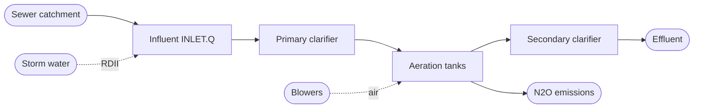
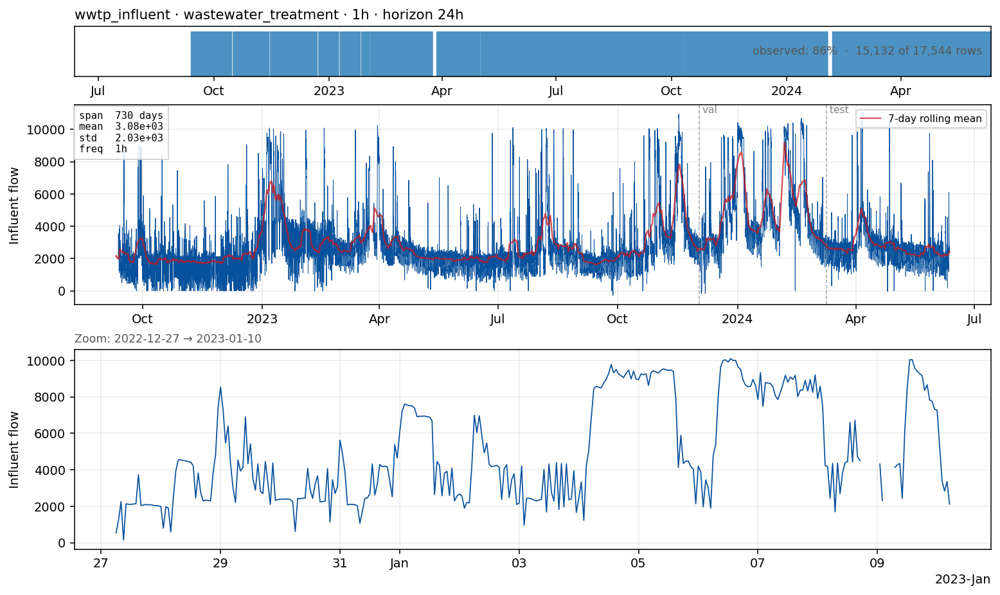

# `wwtp_influent` — influent flow into a wastewater treatment plant

**Domain**: Wastewater treatment · **Target**: hourly influent flow rate · **Horizon**: 24 hours · **Data**: Mendeley N₂O WWTP

## What this is

A WWTP receives the urban sewer catchment's output and removes pollutants before discharging to a river or the sea. **Influent flow** is the most important driver of plant operation: underloads waste energy, overloads cause biomass washout and permit excursions. Short-range influent forecasts feed energy-intensive aeration control (~50 % of plant electricity).
I wouldn't call it mendeley, seems it just seems to be the name of the platform hosting the data; better refer to plant name or something else
The Mendeley N₂O WWTP dataset (Cembrowicz et al., 2024) is **two years of high-resolution data from a single line of a 350,000-PE municipal plant** (June 2022 — June 2024). Native sampling is 2-minute; **49 columns** cover the influent, biological-tank measurements (NH₄, NO₃, PO₄, DO, suspended solids, temperature, N₂O), aeration airflows, valves, and process phase.

## The forecasting problem
I agree with the resolution. Maybe the horizon can be limited to 6 hours, or both 6 and 24 hours.
Forecast **`INLET.Q value`** (total raw influent flow) resampled to **hourly**, **24 hours** ahead. The 24 h horizon matches aeration scheduling and wet-weather response decisions. Pilot is univariate; the dataset's richness makes an exogenous-aware version the highest-leverage Phase B follow-up.

## Dynamics and drivers

Structurally identical to urban water demand but inverted in time and amplified by stormwater. Diurnal + weekly dry-weather pattern (easy; calendar features capture it). The challenge is **rain-derived inflow & infiltration (RDII)** — fast, large inflow surges driven by rainfall in the upstream catchment. Cold-weather infiltration adds a slow seasonal effect.

## Exogenous candidates

- **`INLET.STATE.SWM INLET FLOW`** — separate storm-water-manifold inflow at the same plant; built-in rainfall proxy.
- **External rainfall / radar** at the plant location.
- **Calendar features** + antecedent dry-weather hours.
- **Plant internals** for control-aware variants (NH₄, DO, temperature).

Two **secondary targets** trivially share this source: **effluent NH₄** (compliance) and **N₂O** (the dataset's published focus, climate-relevant). Both should become their own cases once the framework supports multi-target sources.
I would limit to inflows and not outflows, as that's a completely different task and where usually we promote the use of WEST for mechanistic predictions. To differentiate from bellinge case there could be a focus on influent concentrations (if that is actually provided as a measurement in the dataset)
## Operational relevance

Aeration energy optimisation (5–15 % savings = six-figure annual on a 350k-PE plant). Wet-weather process protection (clarifier washout prevention, bypass timing, first-flush storage). Sludge processing planning, permit compliance, energy-market bidding. Most WWTPs today run no quantitative influent forecast or only a seasonal-naive operator overlay.

## References

- Cembrowicz et al. (2024). *Time Series Dataset for Modeling and Forecasting of N₂O in Wastewater Treatment.* arXiv:2407.05959 · [Mendeley xmbxhscgpr/1](https://data.mendeley.com/datasets/xmbxhscgpr/1)
- IWA Benchmark Simulation Model 2 (BSM2) — the canonical synthetic WWTP benchmark, natural future addition.
