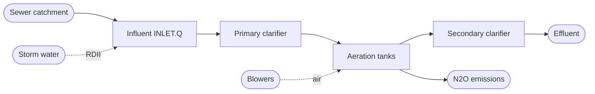
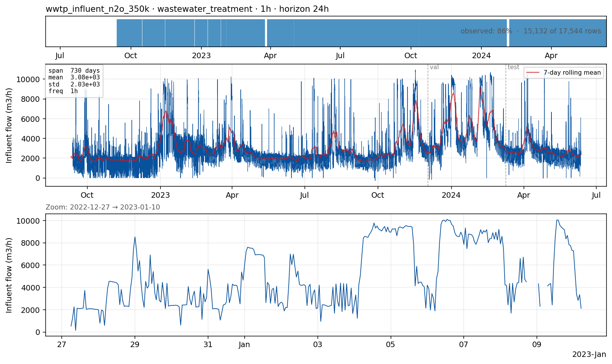

# `wwtp_influent_n2o_350k` — influent flow into a wastewater treatment plant

**Domain**: Wastewater treatment · **Target**: hourly influent flow rate · **Horizon**: 6–24 hours · **Data**: Cembrowicz et al. (2024) N₂O WWTP dataset

## What this is

A WWTP receives the urban sewer catchment's output and removes pollutants before discharging to a river or the sea. **Influent flow** is the most important driver of plant operation: underloads waste energy, overloads cause biomass washout and permit excursions. Short-range influent forecasts feed energy-intensive aeration control (~50 % of plant electricity).

The dataset (Cembrowicz et al., 2024 — published as the "N₂O WWTP" time-series dataset and *hosted* on Mendeley Data; "Mendeley" is the platform, not the plant) is **two years of high-resolution data from a single line of a 350,000-PE municipal plant** (June 2022 — June 2024). Native sampling is 2-minute; **49 columns** cover the influent, biological-tank measurements (NH₄, NO₃, PO₄, DO, suspended solids, temperature, N₂O), aeration airflows, valves, and process phase. *(Naming corrected per Rocco, PR #2.)*

*EDA panel: hourly total raw influent flow (m³/h) at the plant inlet, resampled from
the native 2-minute record. No exogenous overlay yet — the pilot is univariate.*

## The forecasting problem

Forecast **`INLET.Q value`** (total raw influent flow) resampled to **hourly**, evaluated at **6 h and 24 h**. 6 h is the more defensible aeration-control horizon; 24 h additionally spans a full diurnal cycle and wet-weather response decisions. *(Rocco, PR #2: agrees the hourly resolution is right and suggests 6 h, or both 6 h and 24 h.)* Pilot is univariate, but for a sewer-driven influent signal that is only a floor — exogenous rainfall is essential for the wet-weather skill, making the exogenous-aware version the highest-leverage Phase B follow-up.

> **Differentiation from `sewerlevel_bellinge` (Rocco, PR #2).** A combined-sewer level and
> a WWTP influent flow can share almost identical rainfall-driven dynamics. To keep the two
> cases genuinely distinct, the recommended direction is to forecast an **influent
> *concentration*** here (NH₄ / NO₃ / SS at the inlet, if measured in the dataset) rather
> than only flow — a different operational question from in-pipe level. Pending a
> column-availability check (`download --list`).

## Dynamics and drivers

Structurally identical to urban water demand but inverted in time and amplified by stormwater. Diurnal + weekly dry-weather pattern (easy; calendar features capture it). The challenge is **rain-derived inflow & infiltration (RDII)** — fast, large inflow surges driven by rainfall in the upstream catchment. Cold-weather infiltration adds a slow seasonal effect.

## Exogenous candidates

- **`INLET.STATE.SWM INLET FLOW`** — separate storm-water-manifold inflow at the same plant; built-in rainfall proxy.
- **External rainfall / radar** at the plant location.
- **Calendar features** + antecedent dry-weather hours.
- **Plant internals** for control-aware variants (NH₄, DO, temperature).

> **Scope (Rocco, PR #2).** We **keep this case on the influent side only.** Effluent NH₄
> and N₂O — although present in the dataset — are a fundamentally different task (mechanistic
> process modelling, DHI's WEST territory) and mixing influent with effluent muddies the
> case. The earlier idea of spinning `wwtp_effluent_nh4` / `wwtp_n2o` off this source, and of
> adding a synthetic BSM2 case, is **dropped**. Differentiation from Bellinge comes instead
> from an influent *concentration* target (see above), not from effluent.

## Operational relevance

Aeration energy optimisation (5–15 % savings = six-figure annual on a 350k-PE plant). Wet-weather process protection (clarifier washout prevention, bypass timing, first-flush storage). Sludge processing planning, permit compliance, energy-market bidding. Most WWTPs today run no quantitative influent forecast or only a seasonal-naive operator overlay.

## References

- Cembrowicz et al. (2024). *Time Series Dataset for Modeling and Forecasting of N₂O in Wastewater Treatment.* arXiv:2407.05959 · hosted on Mendeley Data: [xmbxhscgpr/1](https://data.mendeley.com/datasets/xmbxhscgpr/1)
