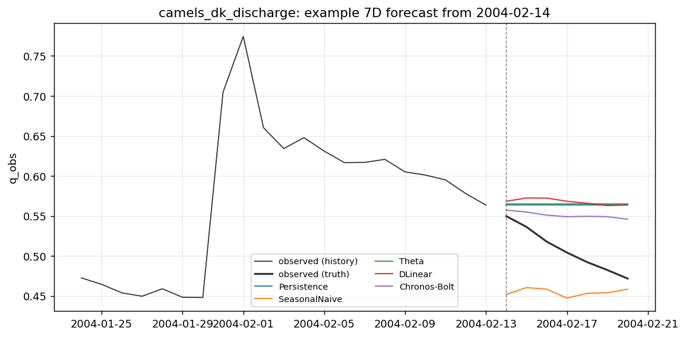
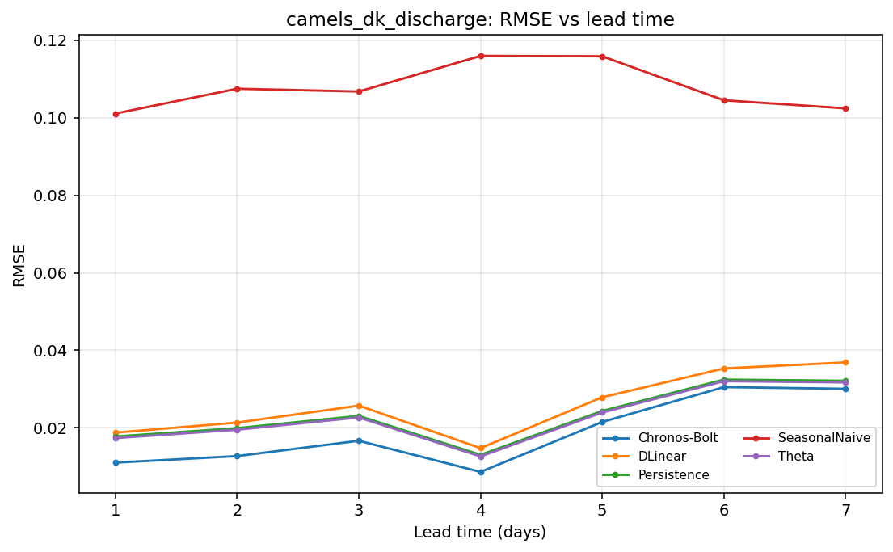

# Case report — `discharge_lowland_denmark`

**Domain** hydrology · **Target** `q_obs` (mm/d) · **Freq** `1D` · **Horizon** `7D`

*Daily river discharge at one Danish lowland catchment from CAMELS-DK. Groundwater-dominated. Pilot uses a single representative gauge until station selection is finalised.*

## Data

- Source: CAMELS-DK — https://essd.copernicus.org/articles/17/1551/2025/
- Record span: 12781 days, 5,843 observed of 12,782 rows (46%)
- Splits (fraction): train→2015-12-31, val→2017-12-31, test→2019-12-31
- Exogenous: precip, temp, pet

## Scores (rolling-origin, pooled over origins x leads)

| method | MASE | skill vs persistence | skill vs mean |
|---|---|---|---|
| Persistence | 0.165 | +0.000 | +0.914 |
| SeasonalNaive | 1.324 | -31.390 | -1.789 |
| Theta | 0.161 | +0.045 | +0.918 |
| DLinear | 0.150 | +0.212 | +0.932 |
| Chronos-Bolt | 0.151 | -0.095 | +0.906 |

## Example forecast

## Error vs lead time

_Generated by `scripts/case_report.py`._