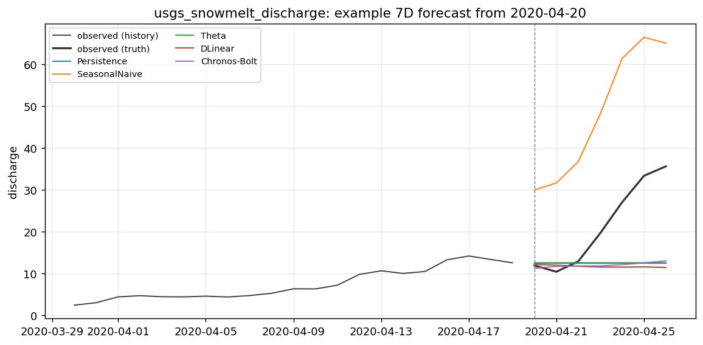
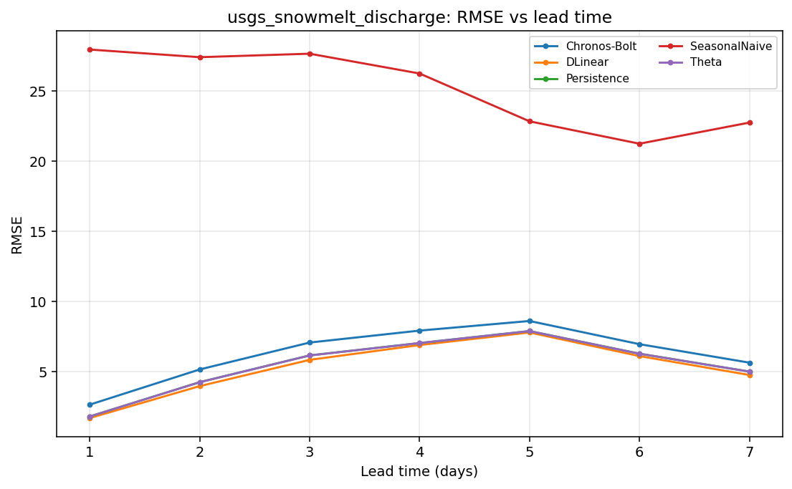

# Case report — `discharge_snowmelt_yosemite`

**Domain** hydrology · **Target** `discharge` (m3/s) · **Freq** `1D` · **Horizon** `7D`

*Daily snowmelt-dominated river discharge at the Merced River at Happy Isles, Yosemite CA (USGS 11264500). A third hydrology regime alongside groundwater-dominated discharge_lowland_denmark and flashy discharge_flashy_catskills: a smooth, strongly seasonal melt hydrograph driven by air temperature (snowmelt) more than by individual rain events. Tests whether method ranking holds across slow / flashy / snowmelt dynamics. Discharge cfs->m3/s; exogenous ERA5 air temperature (primary, melt) + precipitation (Open-Meteo).*

## Data

- Source: USGS NWIS 11264500 — https://waterdata.usgs.gov/monitoring-location/11264500/
- Record span: 4748 days, 4,749 observed of 4,749 rows (100%)
- Splits (calendar): train→2018-12-31, val→2019-12-31, test→2020-12-31
- Exogenous: temp_air, precip (known-future: temp_air, precip)

## Scores (rolling-origin, pooled over origins x leads)

| method | MASE | skill vs persistence | skill vs mean |
|---|---|---|---|
| Persistence | 0.267 | +0.000 | +0.806 |
| SeasonalNaive | 1.871 | -34.292 | -5.846 |
| Theta | 0.268 | -0.006 | +0.805 |
| DLinear | 0.329 | -0.280 | +0.752 |
| Chronos-Bolt | 0.265 | +0.032 | +0.812 |

## Example forecast

## Error vs lead time

_Generated by `scripts/case_report.py`._