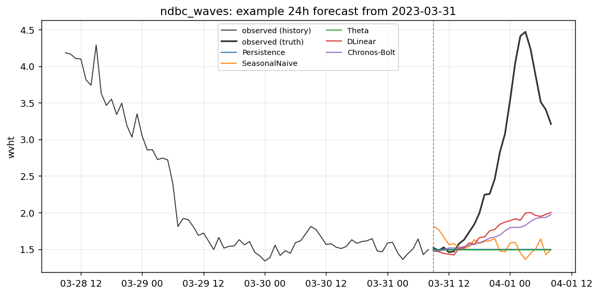
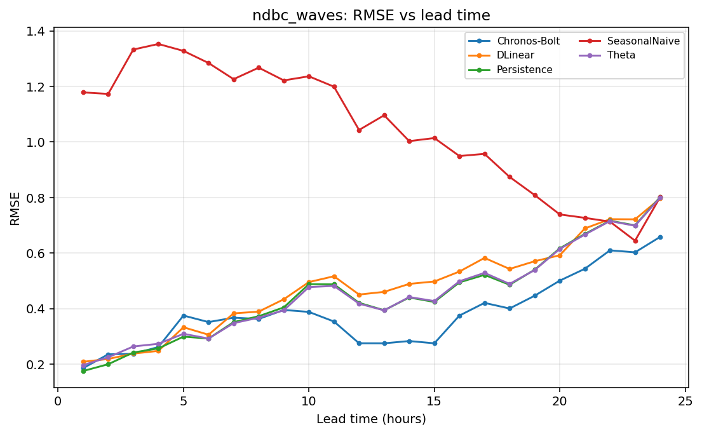

# Case report — `waves_oregon`

**Domain** spectral_waves · **Target** `wvht` (m) · **Freq** `1h` · **Horizon** `24h`

*Significant wave height at a NOAA NDBC buoy (default 46050, Stonewall Bank, Oregon). Hourly. Exogenous from the same buoy's standard met record: wind speed, pressure, air + water temperature. ERA5/GFS wind *forecasts* as known-future covariates can be added later.*

## Data

- Source: NDBC — https://www.ndbc.noaa.gov/
- Record span: 3287 days, 77,815 observed of 78,889 rows (99%)
- Splits (fraction): train→2021-12-31, val→2022-12-31, test→2023-12-31
- Exogenous: wspd, pres, atmp, wtmp

## Scores (rolling-origin, pooled over origins x leads)

| method | MASE | skill vs persistence | skill vs mean |
|---|---|---|---|
| Persistence | 0.984 | +0.000 | +0.202 |
| SeasonalNaive | 1.304 | -0.330 | -0.061 |
| Theta | 0.992 | -0.002 | +0.201 |
| DLinear | 0.821 | +0.213 | +0.372 |
| Chronos-Bolt | 1.031 | -0.183 | +0.056 |

## Example forecast

## Error vs lead time

_Generated by `scripts/case_report.py`._