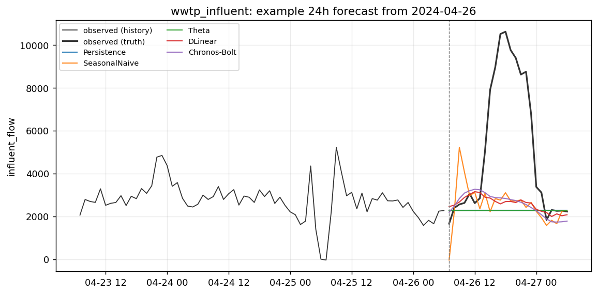
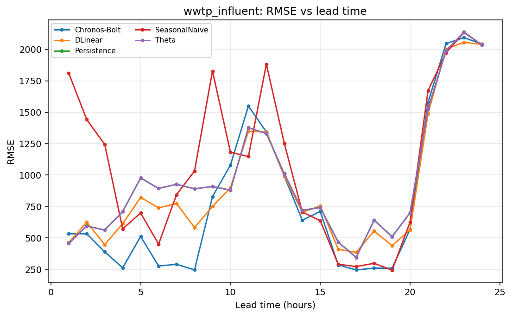

# Case report — `wwtp_influent_n2o_350k`

**Domain** wastewater_treatment · **Target** `influent_flow` (m3/h) · **Freq** `1h` · **Horizon** `24h`

*Influent flow rate at a 350,000 PE WWTP (Mendeley N2O dataset, 2 yrs, 2-min sampling resampled to hourly). Exogenous (rain at plant, temperature, control signals) to be added after inspecting columns via --list; starts univariate.*

## Data

- Source: Hansen et al. (2024) N2O WWTP — https://data.mendeley.com/datasets/xmbxhscgpr/1
- Record span: 730 days, 15,132 observed of 17,544 rows (86%)
- Splits (fraction): train→2023-06-30, val→2023-12-31, test→2024-06-30
- Exogenous: none

## Scores (rolling-origin, pooled over origins x leads)

| method | MASE | skill vs persistence | skill vs mean |
|---|---|---|---|
| Persistence | 0.944 | +0.000 | -0.671 |
| SeasonalNaive | 1.117 | -1.518 | -3.207 |
| Theta | 0.942 | +0.009 | -0.655 |
| DLinear | 0.585 | +0.567 | +0.277 |
| Chronos-Bolt | 0.471 | +0.634 | +0.388 |

## Example forecast

## Error vs lead time

_Generated by `scripts/case_report.py`._